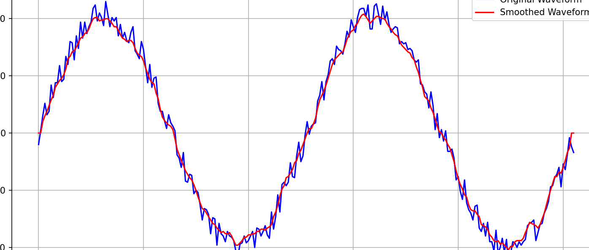
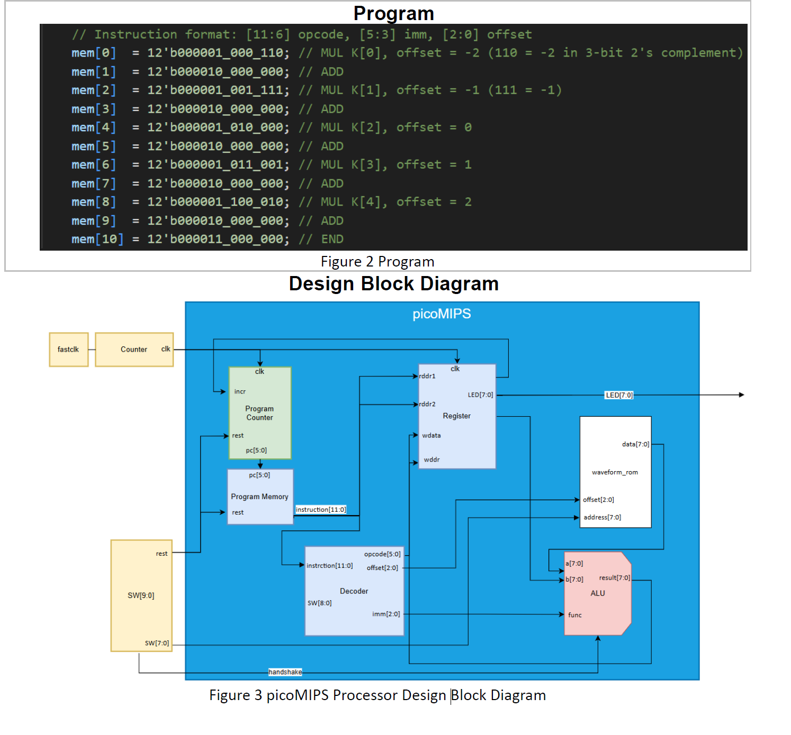
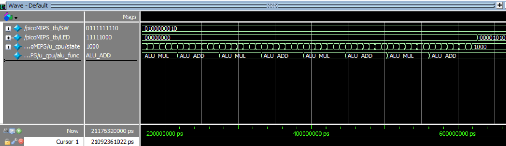
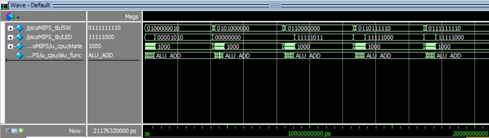
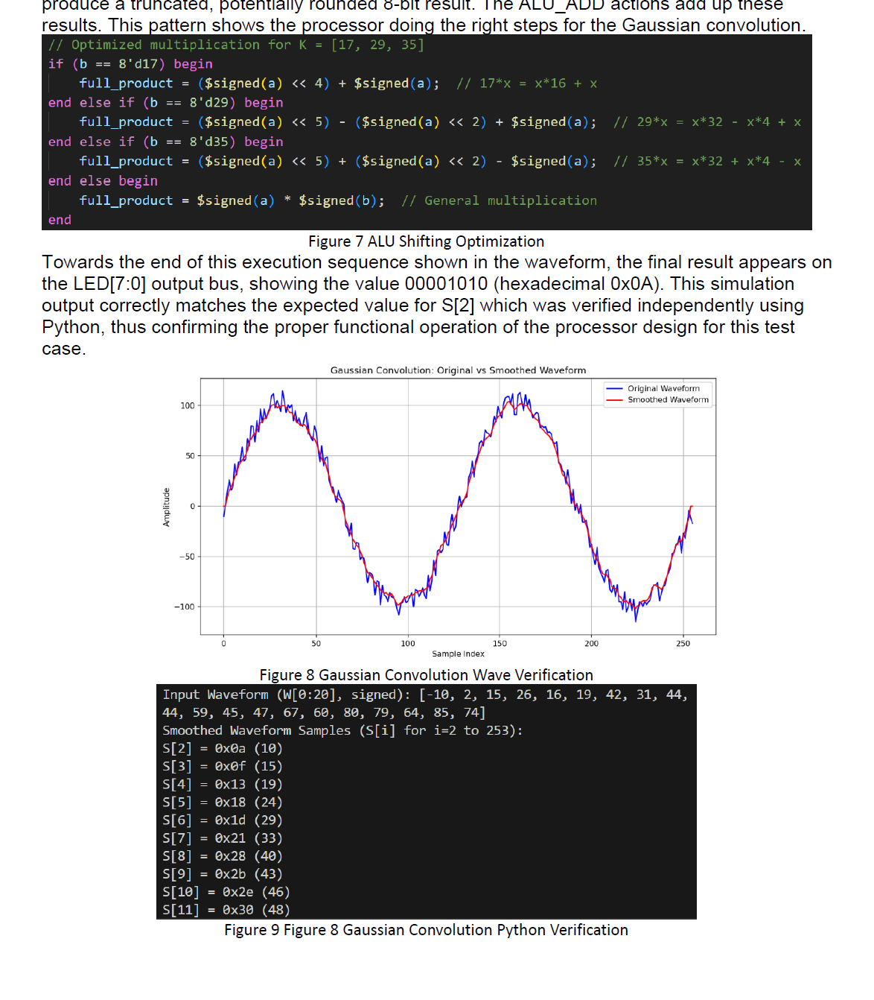

# picoMIPS — Gaussian Smoothing Processor

[繁體中文](README.zh-Hant.md)

An 8-bit application-specific picoMIPS processor written in SystemVerilog. It applies a 5-point Gaussian smoothing filter to a 256-sample noisy sine wave held in ROM, and is optimised for minimal FPGA resource usage on the Altera DE1-SoC board (Cyclone V, 5CSEMA5F31C6).

Coursework for **ELEC6234 Embedded Processors**, University of Southampton (MSc Internet of Things), supervised by Dr Tomasz Kazmierski.

**Hardware cost: 131**, where

```
Cost = ALMs + 500 × max(0, DSP blocks in 9×9 mode − 2) + 30 × Kbits of RAM
```

<p align="center"></p>

## How it works

The processor computes one smoothed sample

```
S[i] = ( 17·W[i−2] + 29·W[i−1] + 35·W[i] + 29·W[i+1] + 17·W[i+2] ) / 128
```

for the index `i` set on the switches. The kernel `K = [17, 29, 35, 29, 17]` is a Gaussian kernel scaled by 128 (in `cpu_pkg.sv`).

| Board I/O | Function |
|---|---|
| `SW[7:0]` | Sample index `i` |
| `SW[8]` | Handshake — start the computation |
| `SW[9]` | Reset |
| `LED[7:0]` | Result `S[i]` (signed 8-bit) |

### Instruction set

12-bit instructions: `[11:6]` opcode, `[5:3]` kernel index, `[2:0]` signed sample offset.

| Opcode | Mnemonic | Operation |
|---|---|---|
| `000001` | `MUL` | Multiply `W[i + offset]` by `K[imm]` |
| `000010` | `ADD` | Add the product to the accumulator |
| `000011` | `END` | Output the result and halt |

The whole filter is an 11-instruction program in `program_memory.sv`:

<p align="center"></p>

### Area optimisations

- **Shift-and-add multiplication** — the ALU multiplies by 17, 29 and 35 with shifts and adds instead of DSP blocks (e.g. `29x = 32x − 4x + x`). The product is scaled by taking bits `[14:7]` (÷128), with rounding for negative results.
- **Multi-cycle FSM** — the CPU steps through `FETCH → EXECUTE → WRITE → OUTPUT` states, so one ALU is shared by all operations.
- **Slow clock** — `counter.sv` divides the 50 MHz board clock (`n = 20`) so results can be seen on the LEDs.

## Files

| File | Description |
|---|---|
| `picoMIPS.sv` | Top level: connects switches, LEDs, clock divider and CPU |
| `picoMIPS4test.sv` | Test wrapper (`fastclk` input) instantiated by the testbench |
| `cpu.sv` | Control FSM and datapath |
| `cpu_pkg.sv` | Instruction widths, ALU function codes, opcodes and Gaussian kernel |
| `opcodes.sv` | Opcode macros |
| `alu.sv` | 8-bit ALU (add, shift-and-add multiply with scaling and rounding) |
| `regs.sv` | Register file |
| `decoder.sv` | Splits an instruction into opcode, kernel index and offset |
| `pc.sv` | 6-bit program counter |
| `program_memory.sv` | Filter program (11 instructions) |
| `waveform_rom.sv` | 256 × 8-bit ROM loaded from `wave.hex` |
| `wave.hex` | Noisy input waveform `W[0..255]` (provided with the coursework) |
| `counter.sv` | Clock divider |
| `picoMIPS_tb.sv` | System testbench: runs `i = 2, 50, 128, 190, 254` and prints `LED` |
| `tb/` | Simulation set with unit testbenches for each module (`alu_tb.sv`, `cpu_tb.sv`, `decoder_tb.sv`, `program_memory_tb.sv`, `regs_tb.sv`, `waveform_rom_tb.sv`) |

> `tb/` contains its own copy of the sources. `alu.sv`, `counter.sv`, `cpu.sv`, `picoMIPS.sv`, `regs.sv` and `waveform_rom.sv` differ from the root versions (for example, `tb/cpu.sv` also clamps negative ROM addresses to 0).

## Simulation (ModelSim / Questa)

Run from the repository root so that `$readmemh("wave.hex")` finds the file:

```tcl
vlib work
vlog -sv cpu_pkg.sv opcodes.sv alu.sv regs.sv decoder.sv pc.sv program_memory.sv \
        waveform_rom.sv counter.sv cpu.sv picoMIPS.sv picoMIPS4test.sv picoMIPS_tb.sv
vsim work.picoMIPS_tb
add wave /picoMIPS_tb/SW /picoMIPS_tb/LED /picoMIPS_tb/uut/u_picoMIPS/u_cpu/state /picoMIPS_tb/uut/u_picoMIPS/u_cpu/alu_func
run -all
```

The testbench prints `LED` for each index. For `i = 2` the processor outputs `0x0A` (10), which matches the Python reference model.

<p align="center"></p>
<p align="center"></p>

## Verification

The hardware results were checked against a Python implementation of the same filter:

<p align="center"></p>

## Synthesis

Create a Quartus project for the DE1-SoC (`5CSEMA5F31C6`), add the root `.sv` files and `wave.hex`, set `picoMIPS` as the top-level entity, and assign `clk`, `SW[9:0]` and `LED[7:0]` to the board pins.

## Reference

Leech, C. and Kazmierski, T.J. (2014) 'Energy Efficient Multi-Core Processing', *Electronics*, 18(1).

## Author

Yu-Cheng Lai ([YCL-Jeff](https://github.com/YCL-Jeff)), University of Southampton
